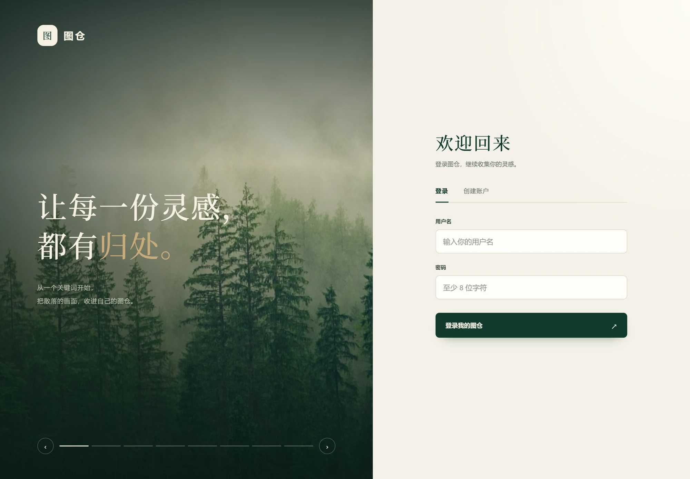
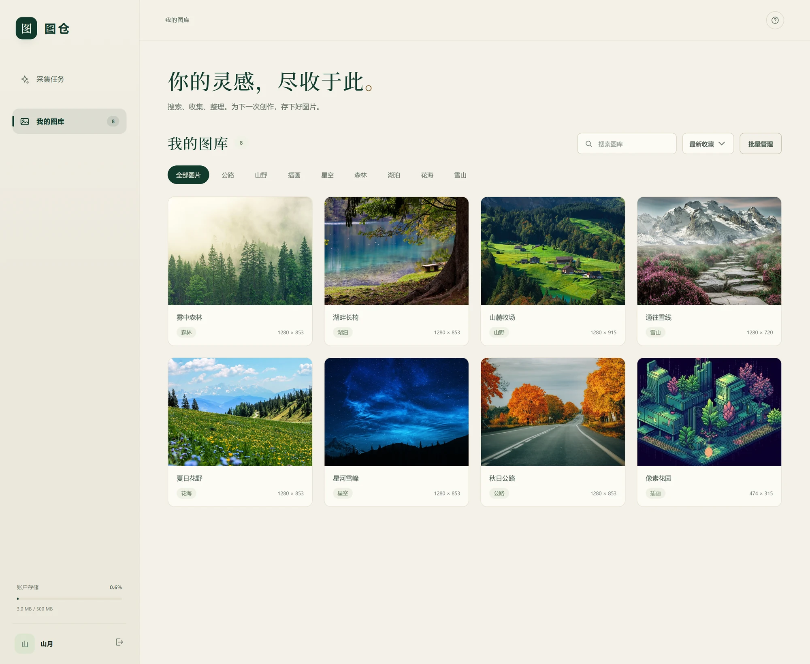
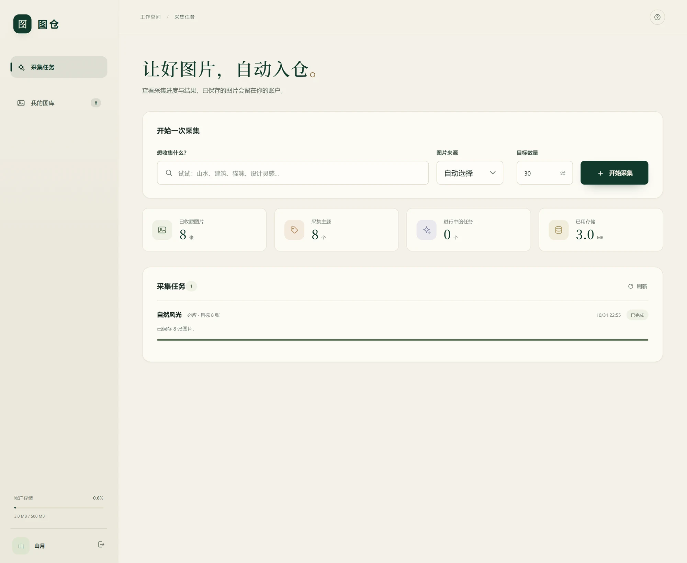
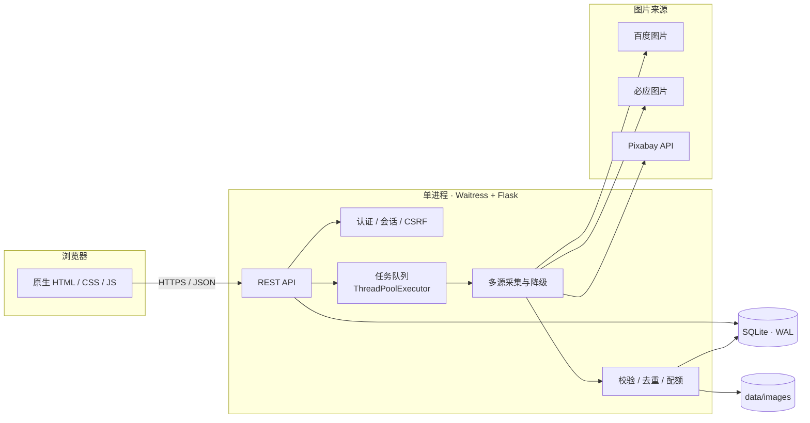

<div align="center">
  <h1>图仓 · Image Vault</h1>
  <p><strong>从一个关键词开始，把散落世界的图片，收进只属于你的私人图库。</strong></p>
  <p><sub>A self-hosted image collector &amp; private gallery — Flask + SQLite + vanilla frontend.</sub></p>

  <p>
    
    
    
    
    
  </p>

  <p>
    <a href="#快速开始">快速开始</a> ·
    <a href="#功能特性">功能特性</a> ·
    <a href="#配置">配置</a> ·
    <a href="#工作原理">工作原理</a> ·
    <a href="#常见问题">常见问题</a>
  </p>
</div>

**图仓** 是一个可自托管的图片采集与图库应用。输入关键词，它会从百度图片、必应图片和 Pixabay 收集图片，校验格式、按内容去重，再按账户隔离保存。

没有 Node.js、没有 Redis、没有外部数据库——一个 Python 进程、SQLite 和一个 `data/` 目录就能跑起来。

## 为什么是图仓

浏览器收藏夹会失效，图床更适合公开分享，素材网站只负责下载——它们都不替你把图片整理成自己的资产。

图仓把 **采集 → 校验 → 去重 → 存储 → 整理** 收进同一个自托管应用：

- **一个关键词就够了**：输入主题，后台自动采集，不需要逐张另存。
- **数据在自己手里**：图片保存在你的服务器，按账户隔离，不经过第三方 SaaS。
- **部署成本低**：单进程 + SQLite + 本地文件，备份就是复制一个目录。
- **坏来源自动绕开**：百度、必应、Pixabay 按顺序降级和补量，单个来源失效不影响任务完成。

## 界面预览

| 登录页 | 我的图库 |
| :---: | :---: |
|  |  |

## 功能特性

### 采集

- **三源采集，自动降级**：百度 → 必应 → Pixabay 顺序尝试；某个来源限流或触发验证时自动切换，并继续补足目标数量。
- **百度浏览器备用模式**：JSON 接口触发安全验证时，使用无头 Chrome 打开正常搜索页；使用独立浏览器上下文，不读取你的浏览器 Cookie。
- **Pixabay 官方 API**：仅保存照片；查询结果缓存 24 小时，API Key 的 100 次/分钟额度由全站共享，避免多账户耗尽。
- **安全下载器**：限制响应大小，逐跳校验重定向，校验 DNS 与公网 IP，拒绝内网地址。

### 图库

- **账户隔离**：所有面向账户的查询都带 `user_id`，图片文件位于 `data/images/<user_id>/`。
- **内容去重**：按 SHA-256 去重，同一张图不会重复占用配额。
- **检索与整理**：关键词分类、全文搜索、最新/最早排序、分页浏览。
- **批量操作**：单张下载，或打包 ZIP（最多 200 张 / 200 MiB）；批量删除。
- **详情查看**：分辨率、大小、来源和原始网页链接。

### 任务

- **异步执行**：后台线程池采集，页面实时显示已保存、重复、失败和进度。
- **随时停止**：停止后已保存的图片仍留在图库。
- **重启保护**：服务重启时，未完成任务标记为「已中断」，不会出现永久 running 的僵尸任务。
- **并发限制**：每账户 1 个活动任务，全站最多 20 个。

## 安全设计

图仓把外部图片当作不可信输入处理：

| 层面 | 措施 |
| --- | --- |
| 账户 | 密码使用 scrypt 哈希；会话 Token 仅存 SHA-256 摘要，7 天过期，可随时撤销 |
| 请求 | 同源校验 + 每会话 CSRF Token；登录/注册按 IP 限制 40 次 / 15 分钟 |
| 网络 | 仅允许公网 HTTP(S)；DNS 校验、固定 IP 连接、逐跳检查重定向，防 SSRF |
| 内容 | Pillow 解码校验与解压炸弹防护；仅接受 JPEG / PNG / WebP / GIF；单图 12 MiB |
| 资源 | 每账户默认 500 MiB 配额；单任务 1–200 张；导出 ≤200 张 / 200 MiB；请求体 ≤64 KB |
| 浏览器 | CSP、X-Frame-Options: DENY、Referrer-Policy、Permissions-Policy、HttpOnly + SameSite Cookie |

> 系统 HTTP 代理仅对百度、必应、Pixabay 的固定搜索/图片端点生效；任意来源图片仍须通过公网地址校验与固定 IP 下载。

## 快速开始

### 环境要求

| 依赖 | 是否必需 | 说明 |
| --- | --- | --- |
| Python 3.11+ | 必需 | 已在 Python 3.14 上测试 |
| Google Chrome | 可选 | 仅百度的浏览器备用模式需要；也可使用 Edge |
| Pixabay API Key | 可选 | 启用 Pixabay 来源时需要，可免费申请 |

### 安装与启动

```bash
git clone https://github.com/czh1316/image-vault.git
cd image-vault
python -m venv .venv
```

激活虚拟环境：

```bash
# Windows CMD
.venv\Scripts\activate
# Windows PowerShell
.venv\Scripts\Activate.ps1
# macOS / Linux
source .venv/bin/activate
```

安装依赖并启动：

```bash
pip install -r requirements.txt
python run.py
```

打开 <http://127.0.0.1:8765>，首次使用创建账户即可。

> 关闭终端会停止服务；仅关闭浏览器不会中断服务端已提交的采集任务。

### 可选：启用 Pixabay

1. 在 [Pixabay API 文档](https://pixabay.com/api/docs/) 申请免费 Key。
2. 设置环境变量 `PIXABAY_API_KEY`，或创建 `data/private-settings.json`：

```json
{"PIXABAY_API_KEY": "your-key-here"}
```

`data/` 已被 `.gitignore` 忽略，Key 不会进入版本库。

### 可选：百度浏览器备用模式

百度 JSON 接口触发安全验证时，图仓会用无头浏览器打开正常搜索页。默认使用系统 Chrome；如需使用 Edge：

```powershell
$env:VAULT_BROWSER_CHANNEL = "msedge"
```

设置 `VAULT_BAIDU_BROWSER=0` 可完全关闭浏览器备用模式。

## 使用流程

1. **创建采集任务**：进入「采集任务」，输入关键词、选择来源与数量（1–200），提交后在后台执行。
2. **等待图片入仓**：任务会显示保存、重复、失败数量和进度；可随时停止，已保存的图片立即进入图库。
3. **整理图库**：在「我的图库」中按关键词筛选、搜索、排序；点击图片查看详情与来源。
4. **导出或删除**：单张下载，或在「批量管理」中选择多张打包 ZIP / 删除。



## 配置

图仓通过环境变量配置。`.env.example` 只是参考，应用**不会自动加载** `.env`；请在启动前设置环境变量，或写入 systemd / 容器配置。

| 变量 | 默认值 | 说明 |
| --- | --- | --- |
| `VAULT_HOST` | `127.0.0.1` | 监听地址 |
| `VAULT_PORT` | `8765` | 监听端口 |
| `VAULT_DATA_DIR` | `<项目>/data` | 持久化数据目录 |
| `VAULT_COVERS_DIR` | `<项目>/image` | 登录页封面图片目录 |
| `VAULT_QUOTA_MB` | `500` | 每账户存储配额（MB） |
| `VAULT_COOKIE_SECURE` | `0` | HTTPS 部署时设为 `1` |
| `PIXABAY_API_KEY` | 空 | Pixabay API Key |
| `VAULT_BAIDU_BROWSER` | `1` | 启用百度浏览器备用模式 |
| `VAULT_BROWSER_CHANNEL` | `chrome` | 浏览器类型（`chrome` / `msedge`） |

```bash
# Linux / macOS
export VAULT_HOST=0.0.0.0
export VAULT_PORT=8765
export VAULT_DATA_DIR=/srv/image-vault/data
export VAULT_COOKIE_SECURE=1
```

```powershell
# Windows PowerShell
$env:VAULT_HOST = "0.0.0.0"
$env:VAULT_PORT = "8765"
$env:VAULT_DATA_DIR = "D:\ImageVaultData"
$env:VAULT_COOKIE_SECURE = "1"
```

也可以直接使用命令行参数：`python run.py --host 0.0.0.0 --port 8765`。

> 登录页封面读取 `VAULT_COVERS_DIR` 中的 JPG / PNG / WebP / GIF，最多展示 12 张；新增文件后刷新页面即可生效。`image/README.md` 中有版权提示。

## 工作原理



服务只有一个进程：Waitress 提供 HTTP，Flask 处理 API，`ThreadPoolExecutor` 执行采集。SQLite 使用 WAL 模式，元数据与图片文件分别落在 `data/vault.sqlite3` 和 `data/images/<user_id>/`。

一次采集的完整链路：

1. 浏览器创建任务，写入 SQLite，并提交到线程池。
2. 调度器按来源搜索，解析候选图片；失败时按「百度 → 必应 → Pixabay」降级或补量。
3. 下载器校验地址、大小、重定向和公网 IP。
4. Pillow 解码校验，计算 SHA-256 去重，检查账户配额。
5. 图片落盘、元数据入库，前端轮询展示进度。

账户隔离在两处生效：所有面向账户的 SQL 查询都带 `user_id`，文件路径也包含 `user_id`。

## 数据来源与限制

| 来源 | 获取内容 | 需要密钥 | 说明 |
| --- | --- | --- | --- |
| 百度图片 | 缩略图 | 否 | JSON 接口优先；触发安全验证时可用无头 Chrome 打开搜索页 |
| 必应图片 | 缩略图 | 否 | 公开 async 搜索接口；可能触发人机验证 |
| Pixabay | 最长边约 1280px 的照片 | 是（免费） | 官方 API；每查询最多 500 条；全站共享 100 次/分钟额度；结果缓存 24 小时 |

- 不绕过验证码，不解析 SVG，不采集视频。
- 分辨率与可用性由来源决定；百度和必应拿到的是缩略图。
- Pixabay 内容遵循其内容许可协议；其他来源的图片版权归原网站及作者所有。
- 采集与使用请遵守来源网站的服务条款和当地版权法律。图仓不提供图片托管或公开分享服务。

## 项目结构

```
image-vault/
├── image_vault/           # 后端核心
│   ├── app.py             # 应用工厂、图库 / 导出 / 统计 API
│   ├── auth.py            # 注册、登录、会话、CSRF、限流
│   ├── crawler.py         # 百度 / 必应 / Pixabay 解析与调度
│   ├── baidu_browser.py   # 百度图片浏览器备用模式
│   ├── pixabay.py         # Pixabay API、24 小时缓存与额度
│   ├── jobs.py            # 异步任务与进度
│   ├── network.py         # 带 SSRF 防护的下载器
│   ├── storage.py         # 图片校验、去重、配额、落盘
│   └── db.py              # SQLite schema 与连接
├── static/                # 原生前端（无构建步骤）
├── image/                 # 登录页封面
├── tests/                 # pytest 测试
├── scripts/               # 实网 / 浏览器验收脚本
├── docs/screenshots/      # README 截图
├── run.py                 # 入口（Waitress）
├── requirements.txt
└── data/                  # 运行时生成（Git 忽略）
    ├── vault.sqlite3
    ├── pixabay-cache.sqlite3
    └── images/<user_id>/
```

## 开发与测试

```bash
pip install -r requirements-dev.txt
python -m pytest tests -q
```

当前 **59 项测试全部通过**（Python 3.14 / Windows 11）。测试覆盖认证与 CSRF、采集中间层、任务状态、Pixabay API、浏览器备用模式，以及图库的删除 / 导出 / 账户隔离。

实网与浏览器验收脚本：

```bash
mkdir analysis
python scripts/verify_pixabay_browser.py   # 合成数据，验证浏览器交互与导出
python scripts/verify_browser.py           # 真实公开搜索的端到端流程
python scripts/verify_sources_live.py      # 真实来源验收，需要 Pixabay Key 与 Chrome
```

脚本会把日志和截图写入 `analysis/`（已被 Git 忽略），因此需要先创建该目录。

## 生产部署

```
[浏览器] → [HTTPS 反向代理] → [Waitress 单进程] → [持久化 data/]
```

1. **单进程运行**：不要同时启动多个指向同一 `data/` 目录的进程；任务队列和 SQLite 写入在进程内协调。
2. **反向代理**：用 Nginx / Caddy 前置 HTTPS，保留原始 `Host` / `Origin`。Caddy 示例：`reverse_proxy 127.0.0.1:8765`。
3. **持久卷**：`VAULT_DATA_DIR` 指向持久化存储；容器化部署时务必挂载该目录。
4. **HTTPS**：设置 `VAULT_COOKIE_SECURE=1`，并让代理传递正确的协议信息。
5. **不要直接暴露 Waitress**：它是应用服务器，不是面向公网的边缘服务器。

systemd 示例：

```ini
[Unit]
Description=Image Vault
After=network.target

[Service]
User=imagevault
WorkingDirectory=/opt/image-vault
Environment=VAULT_HOST=127.0.0.1
Environment=VAULT_PORT=8765
Environment=VAULT_DATA_DIR=/var/lib/image-vault
Environment=VAULT_COOKIE_SECURE=1
ExecStart=/opt/image-vault/.venv/bin/python run.py
Restart=on-failure

[Install]
WantedBy=multi-user.target
```

**备份**：停止服务后完整复制 `data/` 目录（包含 SQLite WAL/SHM 文件和 `images/`），恢复时放回原位置并启动。不要只复制部分文件。

## 常见问题

**Q：不安装 Chrome 可以用吗？**

可以。必应和 Pixabay 不需要浏览器；只有百度触发安全验证后的浏览器备用模式需要 Chrome（或 Edge）。设置 `VAULT_BAIDU_BROWSER=0` 可完全关闭该模式。

**Q：百度采集失败或要求验证？**

百度会按 IP 和频率触发安全验证，图仓不会绕过。自动模式会切换到必应或 Pixabay；也可以手动选择其他来源。稍后重试或更换网络通常能恢复。

**Q：Pixabay 返回 403 / 429？**

403 通常是 Key 无效；429 是请求额度用尽（全站共享 100 次/分钟）。图仓会记录冷却时间并使用 24 小时缓存，稍后重试即可。

**Q：服务重启后任务不见了？**

未完成的任务会被标记为「已中断」，已保存的图片仍在图库。这样不会留下永远 running 的僵尸任务。

**Q：数据如何备份或迁移？**

停止服务，完整复制 `data/` 目录（含 SQLite WAL/SHM 与 `images/`），在新机器上设置相同的 `VAULT_DATA_DIR` 后启动。

**Q：为什么一个任务最多 200 张？**

限制单次任务规模、下载时长与资源占用。需要更多图片可以连续创建多个任务（每账户同时 1 个）。

**Q：可以多用户使用或部署到公网吗？**

可以。图仓按账户隔离，但请放在 HTTPS 反向代理之后，并设置 `VAULT_COOKIE_SECURE=1`；不要将 Waitress 直接暴露在公网。

## Roadmap

- [x] 百度 / 必应 / Pixabay 三源采集与自动降级
- [x] 账户隔离、配额、CSRF、SSRF 防护
- [x] 批量 ZIP 导出与批量删除
- [ ] Docker / Docker Compose 一键部署
- [ ] 图片标签、收藏夹与批量重命名
- [ ] 更多来源（Unsplash、Pexels、Openverse）
- [ ] 可插拔存储后端（S3 / WebDAV）
- [ ] GitHub Actions CI

## 贡献

欢迎 Issue 和 PR。较大的改动请先开 Issue 讨论。提交 PR 前请确保：

```bash
pip install -r requirements-dev.txt
python -m pytest tests -q
```

- 保持「单进程 + SQLite + 无前端构建步骤」的架构约束。
- 新增外部请求时，遵循 `image_vault/network.py` 中的公网校验、大小限制和重定向规则。
- 新增采集来源时，同时补充解析测试与安全边界测试。


## Star History

<a href="https://star-history.com/#czh1316/image-vault&Date">
  <picture>
    <source media="(prefers-color-scheme: dark)" srcset="https://api.star-history.com/svg?repos=czh1316/image-vault&type=Date&theme=dark">
    <source media="(prefers-color-scheme: light)" srcset="https://api.star-history.com/svg?repos=czh1316/image-vault&type=Date">
    
  </picture>
</a>

---

<div align="center">
  <strong>如果图仓帮你把灵感收好了，欢迎点一个 ⭐️</strong>
</div>
